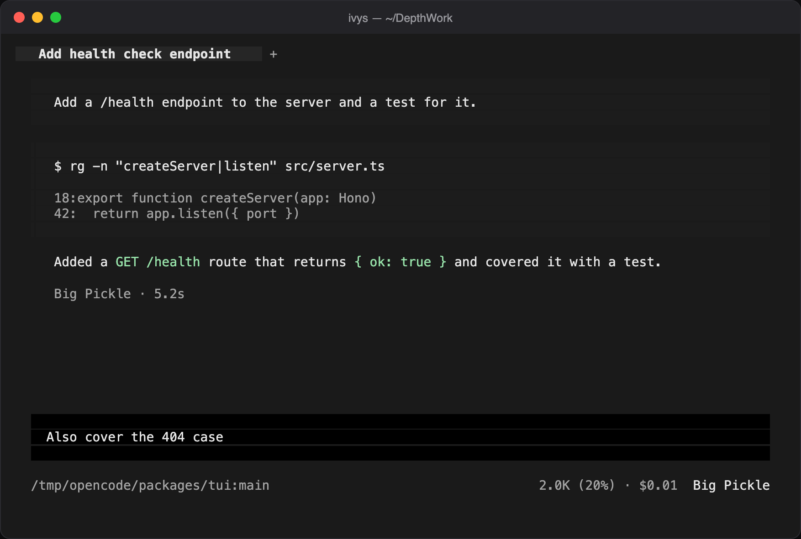

<p align="center"><strong>IvysCode</strong></p>
<p align="center">A terminal AI coding agent.</p>



---

### Installation

```bash
curl -fsSL https://raw.githubusercontent.com/JustinLeoni/ivys/main/install | bash
```

The installer drops the `ivys` binary in `~/.ivys/bin` and adds it to your `PATH`.

Install a specific version:

```bash
curl -fsSL https://raw.githubusercontent.com/JustinLeoni/ivys/main/install | bash -s -- --version v2.0.31
```

Prefer to build from a local binary? Pass `--binary`:

```bash
./install --binary /path/to/ivys
```

### Quick start

```bash
ivys            # start the TUI in the current directory
ivys --version  # verify the install
ivys .          # start in a specific directory
```

### Agents

IvysCode includes two built-in agents you can switch between with the `Tab` key.

- **build** — Default, full-access agent for development work.
- **plan** — Read-only agent for analysis and code exploration.
  - Denies file edits by default.
  - Asks permission before running bash commands.
  - Ideal for exploring unfamiliar codebases or planning changes.

A **general** subagent is also included for complex searches and multi-step tasks.
It runs internally and can be invoked with `@general` in a message.

### Configuration

IvysCode keeps its own identity and state on your machine (binary and config under `~/.ivys`, config directory `~/.config/ivys`) while using the same models and providers as OpenCode.
